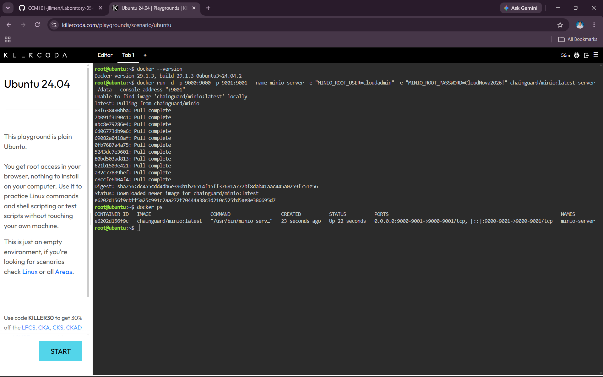
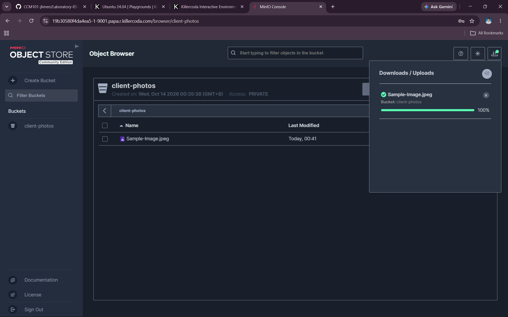
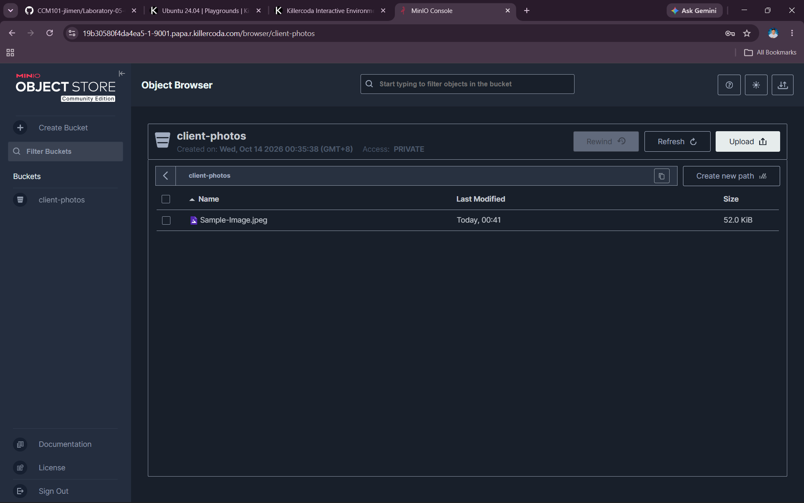

# MinIO Deployment

## Overview

For this laboratory activity, I deployed MinIO as an S3-compatible object storage server using Docker in a KillerCoda Ubuntu Playground. The deployment allowed me to access the MinIO Web Console, create an object storage bucket, and upload a sample file.

## Docker Version

I first verified that Docker was installed by running:

```bash
docker --version
```

## Docker Deployment Command

I used the following command to deploy the MinIO server:

```bash
docker run -d -p 9000:9000 -p 9001:9001 --name minio-server -e "MINIO_ROOT_USER=cloudadmin" -e "MINIO_ROOT_PASSWORD=CloudNova2026!" chainguard/minio:latest server /data --console-address ":9001"
```

## Verifying the Container

After starting MinIO, I verified that the container was running by using:

```bash
docker ps
```

The running container was named:

```text
minio-server
```

## Port Configuration

The MinIO deployment used two ports:

- **Port 9000** - MinIO API port
- **Port 9001** - MinIO Web Console port

The Web Console was accessed through port **9001**.

## Environment Variables

The `-e` flags were used to define environment variables for the MinIO container.

```text
-e "MINIO_ROOT_USER=cloudadmin"
```

This sets the root username for the MinIO server.

```text
-e "MINIO_ROOT_PASSWORD=CloudNova2026!"
```

This sets the root password for the MinIO server.

These credentials were then used to log in to the MinIO Web Console.

## Bucket Created

The storage bucket created during this activity was:

```text
client-photos
```

The bucket was used to store a sample uploaded file.

## Screenshots

### MinIO Deployment



### MinIO Bucket and Uploaded File




## Result

The MinIO object storage server was successfully deployed using Docker. I was able to access the Web Console, create the `client-photos` bucket, and upload a sample file.
