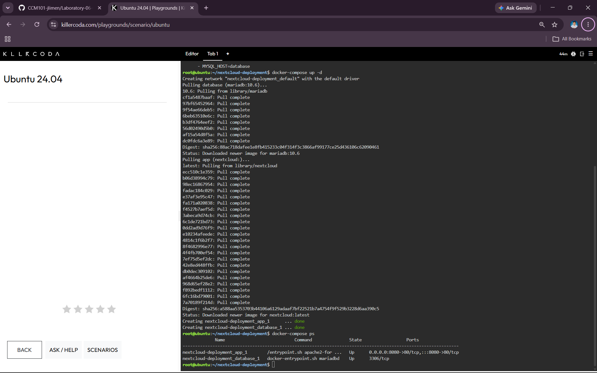
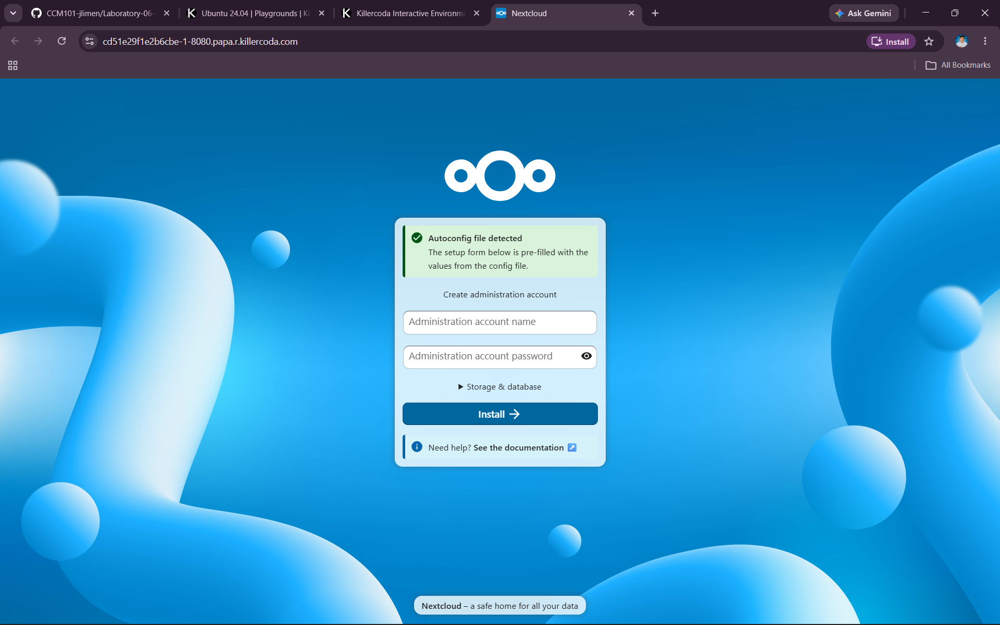
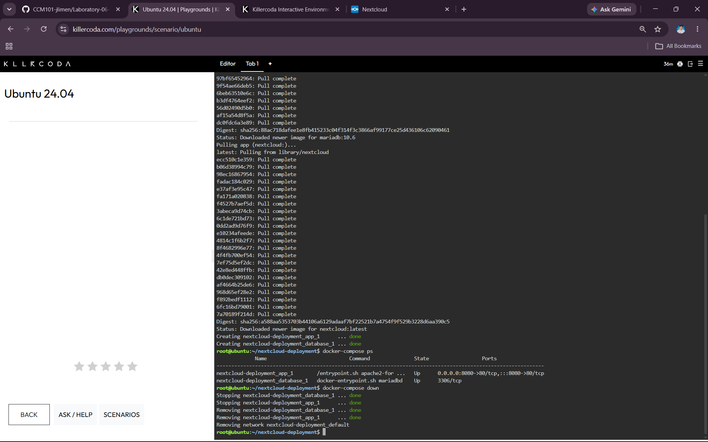

# Laboratory 06 – The Cloud Deployment Engineer

## Mission Overview

This laboratory focused on deploying a multi-tier cloud application using Docker Compose. The application consisted of a Nextcloud web application and a MariaDB database running in separate containers.

The laboratory introduced Infrastructure as Code (IaC) by using a `docker-compose.yml` configuration file to define and deploy the application infrastructure.

## Objectives

The objectives of this laboratory were to:

- Explain the concept of multi-tier application architecture.
- Understand the purpose and structure of a `docker-compose.yml` file.
- Use the Linux command-line text editor Nano to create a configuration file.
- Deploy a multi-container application using Docker Compose.
- Document deployment procedures and Infrastructure as Code principles using Markdown.
- Continue expanding the CCM101 Cloud Computing GitHub portfolio.

## Commands Executed

The following commands were used during the laboratory:

### 1. Create the Project Directory

```bash
mkdir nextcloud-deployment
```

Creates a new directory named `nextcloud-deployment` for the Docker Compose project.

### 2. Enter the Project Directory

```bash
cd nextcloud-deployment
```

Moves into the `nextcloud-deployment` directory so that the project files can be created there.

### 3. Create the Docker Compose File

```bash
nano docker-compose.yml
```

Opens the Nano text editor to create and edit the `docker-compose.yml` configuration file.

### 4. Deploy the Containers

```bash
docker-compose up -d
```

Starts the services defined in the `docker-compose.yml` file. The `-d` option runs the containers in the background.

### 5. Check the Containers

```bash
docker-compose ps
```

Displays the status of the Docker Compose services and allows us to check whether the containers are running.

### 6. Stop and Remove the Containers

```bash
docker-compose down
```

Stops and removes the containers created by Docker Compose after completing the deployment.

## Skills Learned

Through this laboratory, I learned:

- How to create and use a `docker-compose.yml` configuration file.
- How to define multiple services in Docker Compose.
- How Nextcloud communicates with a MariaDB database container.
- How to deploy a multi-container application using Docker Compose.
- How to check the status of running containers.
- How to access a containerized web application through port mapping.
- How Infrastructure as Code (IaC) can make cloud infrastructure easier to organize and manage.
- How to document cloud deployment procedures using Markdown.

## Evidence

### `compose-deployment.png` – Docker Compose deployment and running containers

This screenshot shows the Docker Compose deployment and the running containers.



### `nextcloud-web.png` – Nextcloud web installation page

This screenshot shows the Nextcloud installation page accessed through port 8080.



### `compose-teardown.png` – Container teardown

This screenshot shows the containers being stopped and removed using Docker Compose.


