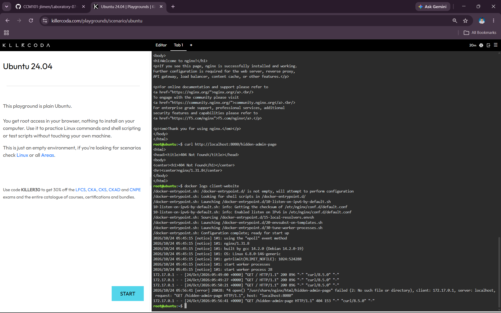
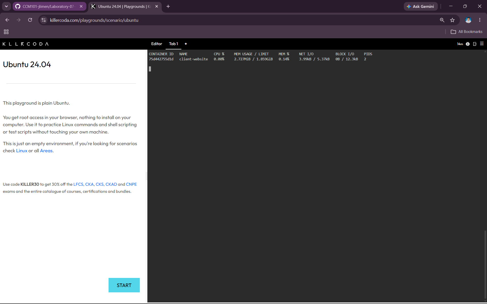

# Container Observability

## Application Logs

I retrieved the application logs from the Nginx container using:

```bash
docker logs client-website
```

The logs showed the HTTP requests made to the web server, including successful requests and the request that produced a `404 Not Found` error.

## 404 Error Log

The log line showing the `404` error was:

```text
172.17.0.1 - - [24/Oct/2026:05:56:41 +0000] "GET /hidden-admin-page HTTP/1.1" 404 153 "-" "curl/8.5.0" "-"
```

## Why Application Logs Are Important

Application logs are vital for troubleshooting because they provide information about requests and errors that occur while an application is running. They help a Cloud Operations Engineer identify problems and understand what happened when users experience an issue.

### Screenshot



---

# Real-Time Container Metrics

## Docker Stats

I used the following command to monitor the container's resource consumption:

```bash
docker stats
```

The command provided real-time information about the container's CPU usage, memory usage, and network input/output.

## Client Website Metrics

| Metric | Result |
|---|---|
| Container | `client-website` |
| CPU Usage | **0.00%** |
| Memory Usage | **2.727MiB** |
| Network I/O | **3.99kB / 5.37kB** |

### Screenshot



The application logs provided information about requests and errors, while Docker metrics provided real-time information about the container's resource consumption. Together, these two types of information help determine whether the application and its container are operating properly.
