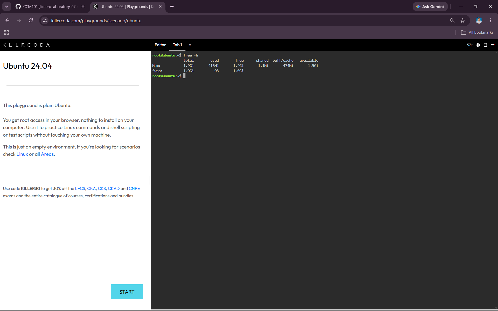
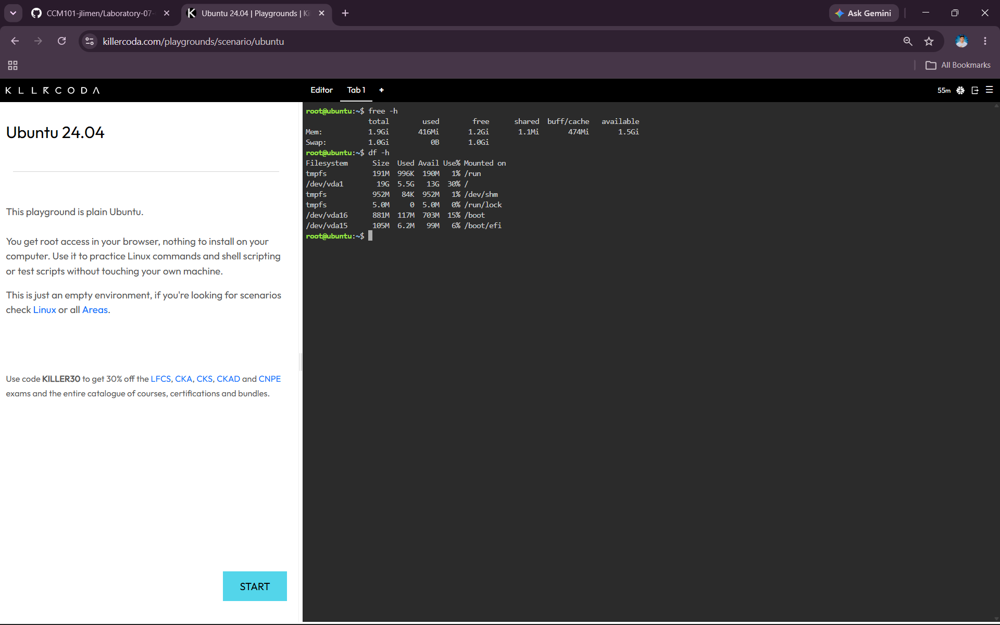

# System Baseline Report

## Host System Baseline

Before deploying the client web server, I checked the Linux host system to establish a baseline of its current resources. The baseline included the server's memory, disk storage, and CPU/process activity.

## Memory Check

I used the following command to check the available memory:

```bash
free -h
```

The total RAM available on the server was:

**1.9Gi**

### Screenshot



## Disk Check

I used the following command to check the available disk storage:

```bash
df -h
```

The total storage capacity of the root `/` file system was:

**19G**

### Screenshot



## CPU and Process Check

I used the following command to observe the active processes and CPU load:

```bash
top
```

I observed the changing CPU and process information for approximately more than five seconds before exiting the command using `q`.

## Why Disk Space Is Important

Checking disk space is critical before a massive traffic surge because increased activity can generate additional data, logs, and other files that may consume available storage and affect the server's operation.

## Baseline Summary

| Resource | Result |
|---|---|
| Total RAM | 1.9Gi |
| Root `/` Storage Capacity | 19G |
| CPU/Process Monitoring Tool | `top` |
| Memory Monitoring Tool | `free -h` |
| Disk Monitoring Tool | `df -h` |
