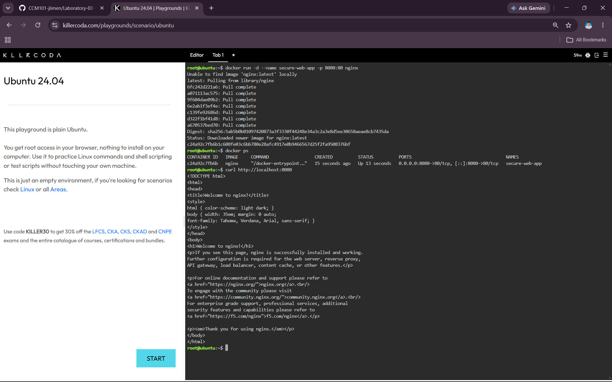
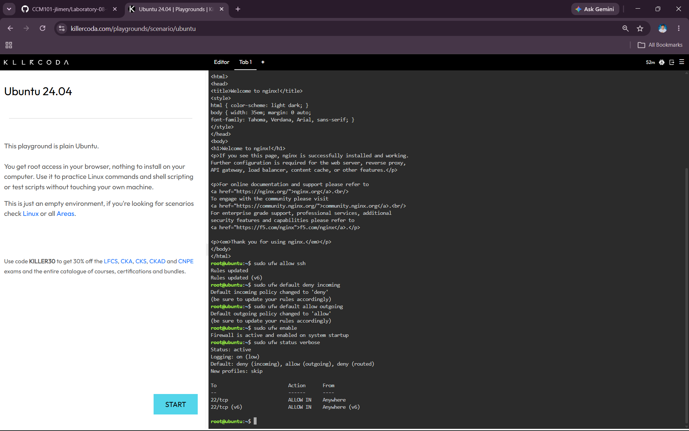
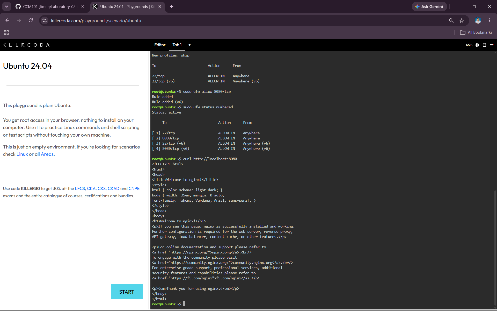

# Laboratory 08 – The Cloud Security Engineer

## Mission Overview

Laboratory Activity 8 focused on securing a Linux server using a host-based firewall. In this activity, I deployed an Nginx web application using Docker and configured UFW to protect the server. I used a Default Deny policy and allowed only the required SSH and web application traffic.

## Objectives

- Understand the concept of the Attack Surface and the Principle of Least Privilege (PoLP).
- Perform a basic security audit of active network ports on a Linux server.
- Configure the Uncomplicated Firewall (UFW) with a Default Deny policy.
- Implement granular port management to selectively allow SSH and HTTP traffic.
- Document firewall rules and security best practices using Markdown.
- Continue expanding my professional GitHub Cloud Computing Portfolio.

## Commands Executed

### 1. Deploy the Nginx Web Application

```bash
docker run -d --name secure-web-app -p 8080:80 nginx
```

This command creates and runs an Nginx web server in a Docker container. Port 8080 on the server is connected to port 80 inside the container.

### 2. Check the Running Container

```bash
docker ps
```

This command displays the running Docker containers and confirms that the `secure-web-app` container is running.

### 3. Test the Web Application

```bash
curl http://localhost:8080
```

This command checks if the Nginx web application can be accessed through port 8080. A successful response displays the Nginx welcome page.

### 4. Allow SSH

```bash
sudo ufw allow ssh
```

This command allows SSH traffic so that administrators can continue to access and manage the server.

### 5. Set Default Deny for Incoming Traffic

```bash
sudo ufw default deny incoming
```

This command blocks incoming network traffic by default unless it is specifically allowed by a firewall rule.

### 6. Allow Outgoing Traffic

```bash
sudo ufw default allow outgoing
```

This command allows the server to make outgoing network connections by default.

### 7. Enable the Firewall

```bash
sudo ufw enable
```

This command activates the UFW firewall and applies the configured firewall rules.

### 8. Check Firewall Status

```bash
sudo ufw status verbose
```

This command displays the current UFW status, default policies, and active firewall rules.

### 9. Allow Port 8080

```bash
sudo ufw allow 8080/tcp
```

This command allows TCP traffic through port 8080 so users can access the Nginx web application.

### 10. Check Firewall Rules

```bash
sudo ufw status numbered
```

This command displays the active firewall rules with numbers, making it easier to review and manage them.

## Skills Learned

- Understanding the **Attack Surface** of a Linux server.
- Understanding the **Principle of Least Privilege (PoLP)**.
- Performing a basic security audit of network services and ports.
- Deploying a web application using **Docker and Nginx**.
- Configuring **UFW (Uncomplicated Firewall)**.
- Applying a **Default Deny** policy for incoming traffic.
- Allowing only the required network ports.
- Managing **SSH access** through a firewall.
- Managing **TCP port 8080** for a web application.
- Checking and reviewing active firewall rules.
- Documenting security configurations using **Markdown**.
- Organizing security documentation and evidence in a **GitHub Cloud Computing Portfolio**.

## Screenshot Evidence

### 1. Nginx Web Application Running



This screenshot shows the successful deployment of the Nginx web application. The `curl` command returned the Nginx welcome page, confirming that the application was running on port 8080.

### 2. Firewall Activated



This screenshot shows that UFW was successfully enabled. The firewall status shows that incoming traffic is denied by default and outgoing traffic is allowed.

### 3. Port 8080 Allowed



This screenshot shows the numbered UFW rules, including SSH on port 22 and the web application on port 8080. The successful `curl` test also confirms that the web application remained accessible.
