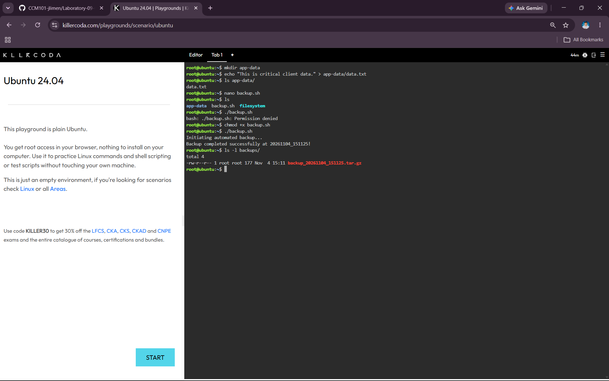
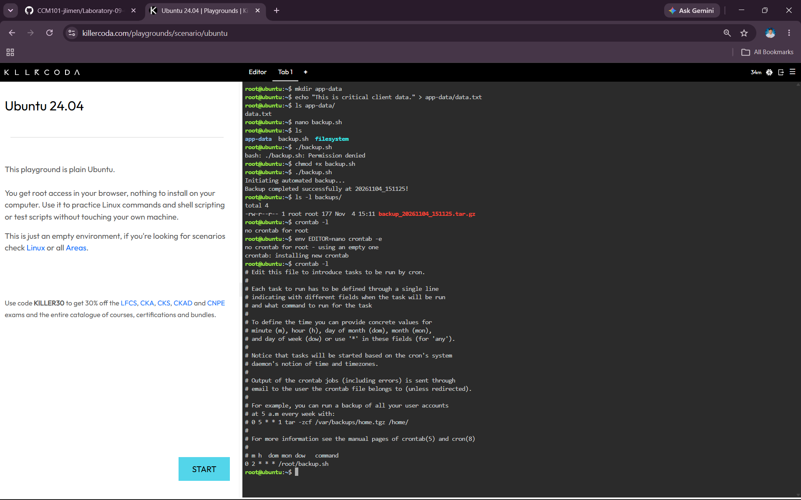

# Laboratory 09 – The Cloud Automation Engineer

## Mission Overview

This laboratory activity focuses on learning the fundamentals of cloud automation using Bash shell scripting and Linux Cron scheduling. Using the KillerCoda Ubuntu Playground, I created a sample application directory, developed an automated backup script, configured executable permissions, and scheduled the backup process to run automatically every day at 2:00 AM.

This activity demonstrates how automation can reduce repetitive manual tasks, minimize human errors, and improve efficiency when managing cloud environments.

## Objectives

- Understand the fundamental syntax of a Bash shell script, including variables and basic commands. 
- Use a command-line text editor (nano) to write and save executable scripts. 
- Modify Linux file permissions using the chmod command. 
- Understand task scheduling and the syntax of a Linux crontab. 
- Document automation code and Cron job configurations using Markdown. 
- Complete the final chapter of your GitHub Cloud Computing Portfolio. 

## Commands Executed

### 1. Create the Application Data Directory

```bash
mkdir app-data
```

Creates a directory named `app-data` to represent the client's application data.

### 2. Create a Sample Data File

```bash
echo "This is critical client data." > app-data/data.txt
```

Creates a sample text file inside the application data directory.

### 3. Create the Bash Backup Script

```bash
nano backup.sh
```

Opens the Nano text editor to create the backup script.

### 4. Attempt to Execute the Script

```bash
./backup.sh
```

Initially, the terminal displayed a `Permission denied` error because the script did not have executable permission.

### 5. Grant Executable Permission

```bash
chmod +x backup.sh
```

Adds executable permission to the Bash script.

### 6. Execute the Backup Script

```bash
./backup.sh
```

Runs the backup script and creates a compressed archive of the application data directory.

### 7. Verify the Generated Backup

```bash
ls -l backups/
```

Displays the generated backup file inside the backups directory.

### 8. Check Existing Cron Jobs

```bash
crontab -l
```

Checks the currently installed Cron jobs.

### 9. Open the Cron Editor

```bash
env EDITOR=nano crontab -e
```

Opens the Nano editor to configure the scheduled task.

### 10. Verify the Installed Cron Schedule

```bash
crontab -l
```

Displays the installed Cron configuration.

**Cron Expression:**

```bash
0 2 * * * /root/backup.sh
```

This schedules the backup script to execute automatically every day at 2:00 AM.

## Skills Learned

- Bash shell scripting and basic command automation.
- Using variables to manage directory paths and timestamps.
- Creating and editing files using the Nano text editor.
- Managing Linux file permissions using `chmod`.
- Compressing application data using the `tar` command.
- Creating automated backup routines.
- Scheduling recurring tasks using Linux Cron.
- Documenting technical activities and configurations using Markdown.
- Understanding the importance of automation in cloud operations.

## Screenshots

### 1. Script Execution

This screenshot shows the successful execution of the backup script and the generated compressed backup file.



### 2. Cron Schedule

This screenshot shows the installed Cron job configured to execute the backup script every day at 2:00 AM.



